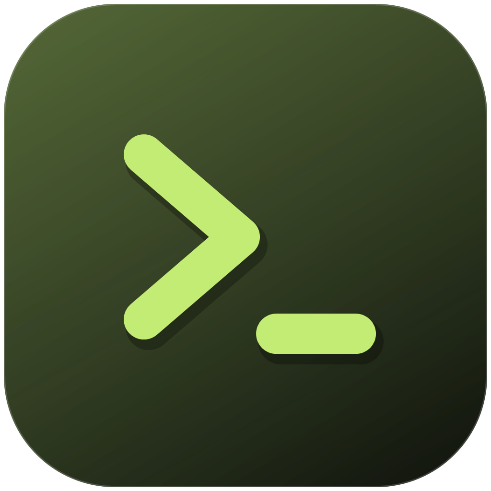

# myterm

一个 Windows 终端：GPUI Kit 做界面，[libghostty-vt](https://lib.ghostty.org/vt/index.html) 1.0.0 的 C API 做 VT 解析。

状态：**可运行**。终端渲染、键盘输入、多标签、分屏与拖动调整比例、选区与复制、光标闪烁、滚轮回滚、配色与退出提示均已人工验证。设计见 [docs/design.md](docs/design.md)。



## 构建与运行

前置：

- Windows 10 1809+ / Windows 11，MSVC 目标（`x86_64-pc-windows-msvc`）
- Rust 1.90+
- Visual Studio Build Tools（C++ 工作负载）与 Windows SDK

不需要 CMake、Zig 或任何系统级依赖：`libghostty-vt` 的静态库已随仓库提供。

```sh
cargo build -p app     # 构建
cargo run -p app       # 打开窗口
cargo test             # 布局与 VT 绑定的单元测试
```

## 结构

```
crates/
  vt-sys/   libghostty-vt 1.0.0 的裸 FFI 声明 + 预编译静态库
  vt/       安全封装：所有权、错误、颜色、渲染状态、按键编码
  pty/      ConPTY 进程与读写线程
  app/      GPUI Kit 界面：标签、窗格、渲染、快捷键
```

依赖只向下：`app → pty/vt → vt-sys`。`vt-sys` 之外没有 `unsafe`。

## 功能

- **终端渲染**：字体为 Maple Mono NF CN（等宽编程字体，自带中文字形与 Nerd Font 图标），自定义 `Element` 按行迭代绘制，支持粗体、斜体、下划线、反显、隐藏、删除线与上划线；宽字符占两格。
- **窗口**：自绘标题栏，标签就排在系统标题栏的位置上；空白处可拖动窗口，右侧是最小化/最大化/关闭。窗口框架跟随主题深浅。
- **主题**：跟随系统深浅色启动，`Ctrl+Shift+L` 或标题栏的太阳/月亮按钮切换；终端前景、背景、光标与 ANSI 16 色会随主题一起换，不只是外壳。
- **中文输入**：窗格把自己注册为平台文本输入目标，输入法组字提交后写入 PTY。
- **输入**：普通字符、功能键、方向键、`Ctrl` 组合键；按键编码交给解析器，因此 `application cursor keys` 等模式自动正确。
- **标签**：新建（`Ctrl+Shift+T`）、关闭（`Ctrl+Shift+Q`）；标题跟随 shell 的 OSC 标题，路径会被截成文件名。
- **分屏**：左右（`Ctrl+Shift+D`）、上下（`Ctrl+Shift+E`）、关闭窗格（`Ctrl+Shift+W`）、`Alt+方向键` 切换；窗格之间留出间距，拖动分隔条即可调整比例。分成多个窗格后，把鼠标移到任意窗格上，右上角会出现两个小按钮，可以在该窗格内继续分屏，不必回到标题栏。
- **光标**：按终端请求显示竖线、下划线、空心块或实心块；实心块会把下面的字符反色重绘，所以光标压住的那一格仍然可读。默认闪烁，光标移动后立即恢复实心。
- **选区**：按住左键拖动高亮选中的文字，`Ctrl+C` 复制选区；没有选区时复制整屏。
- **滚动条**：有回滚历史时右侧显示轨道与滑块，滑块按可见行数占比收缩。
- **配色**：ANSI 16 色与默认前景/背景注入解析器，因此查询颜色的程序得到与渲染一致的值。
- **退出提示**：进程退出后在窗格底部显示退出码，保留最后一帧输出。
- **剪贴板**：`Ctrl+C` 复制选区，没有选区时复制整屏；`Ctrl+V` 粘贴。
- **滚轮**：回滚视口，超出半屏自动回到底部。

## 已知限制

- 系统磨砂材质（Mica / Acrylic）无法透出：Windows 后端通过 DirectComposition 呈现不透明表面，DWM 的材质被它盖住。标题栏改用自绘的色阶与顶部高光线做出层次。
- 查找尚未接入（`vt` 层已提供搜索接口）。
- 中文输入已接通输入法通道，但组字过程的端到端效果需要真机手动验证。
- 仅支持 Windows。
- 字体依赖本机安装 Maple Mono NF CN；未安装时会回退到系统默认等宽字体。
