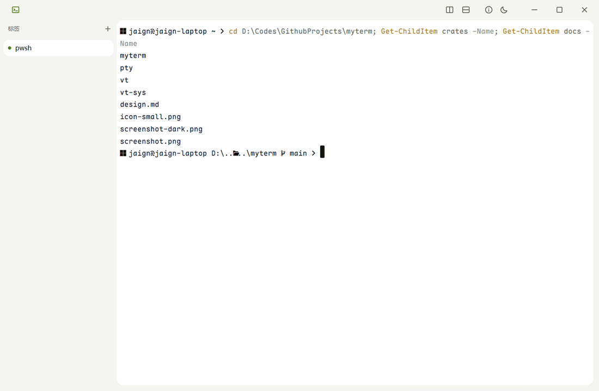

# myterm

一个为 Windows 写的终端。VT 解析交给 [libghostty-vt](https://lib.ghostty.org/vt/index.html) 的 C API，界面用 [GPUI Kit](https://gpui-kit.com)，其余每一层都是自己的代码，并且能单独测试。

[](https://github.com/tiramission/myterm/actions/workflows/ci.yml)
[](https://github.com/tiramission/myterm/releases/latest)


<picture>
  <source media="(prefers-color-scheme: dark)" srcset="docs/screenshot-dark.png">
  
</picture>

终端渲染、键盘与中文输入、多标签、分屏与拖动比例、选区与复制、滚轮回滚、Kitty 图形协议、深浅主题、自动更新与安装都已人工验证。设计取舍写在 [docs/design.md](docs/design.md)。

## 三个决定

**标签在侧边，不在顶部。** 顶部那一行留给窗口本身。左侧一栏就是标签栏：默认是最窄的窄条，一个标签一个胶囊，当前标签用强调色描边；展开后变成一行一个标签、多窗格的标签带缩进的窗格行。宽度只由你决定，分屏不会把它撑开。

**窗格是卡片，外壳是底。** 卡片之间留 10px 的外壳色，那 10px 就是分隔线本身——不额外画线。指针停在间隙上会浮出一小段强调色手柄，说明这里能拖。

**强调色只说明一件事：这里是当前。** 青柠色用在应用标记、当前标签的描边、键盘所在的窗格、可拖动的间隙，以及有输出或待更新的状态上。它不拿来装饰——所以看到它，它总在回答「现在在哪」或「有东西在动」。

## 安装

从 [Releases](https://github.com/tiramission/myterm/releases/latest) 下载 `myterm.exe` 直接运行即可，不需要管理员权限。

第一次启动时标题栏下面会出现一条提示带，点「安装」把程序装到 `%LOCALAPPDATA%\Programs\myterm`：建开始菜单和桌面快捷方式、写入「设置 → 应用」里的卸载项，然后重启到装好的副本。之后启动自动检查新版本，标题栏出现徽章时点一下即可升级。

卸载走同一个 `--uninstall`，在「设置 → 应用」里点卸载，或在信息浮层里点「卸载」。


## 快捷键

| 按键 | 作用 |
| --- | --- |
| `Ctrl+Shift+T` | 新建标签 |
| `Ctrl+Shift+Q` | 关闭标签 |
| `Ctrl+Shift+W` | 关闭窗格 |
| `Ctrl+Shift+D` | 左右分屏 |
| `Ctrl+Shift+E` | 上下分屏 |
| `Ctrl+Shift+Z` | 缩放当前窗格 |
| `Ctrl+Shift+B` | 收起 / 展开侧栏 |
| `Ctrl+Shift+C` / `Ctrl+Shift+V` | 复制选区 / 粘贴 |
| `Ctrl+Shift+L` | 切换深浅主题 |
| `Alt+方向键` | 切换窗格 |

复制粘贴用带 `Shift` 的组合，因为终端必须把 `Ctrl+C`（中断前台程序）和 `Ctrl+V`（readline 的引号插入）原样交给 shell。

## 功能

### 终端

- **渲染**：自定义 `Element` 按行迭代绘制，支持粗体、斜体、下划线、反显、隐藏、删除线、上划线；宽字符占两格。默认字体 Maple Mono NF CN（自带中文字形与 Nerd Font 图标），未安装时回退到系统等宽字体。
- **输入**：普通字符、功能键、方向键、`Ctrl` 组合键都交给解析器编码，所以 application cursor keys、modifyOtherKeys 等模式自动正确。
- **中文输入**：窗格把自己注册为平台文本输入目标，输入法提交后写入 PTY；候选窗跟随光标。
- **光标**：按终端请求显示竖线、下划线、空心块或实心块。实心块会把下面的字符反色重绘，光标压住的那一格仍然可读。
- **选区**：按住左键拖动高亮，`Ctrl+Shift+C` 复制。没有选区时复制不做任何事——把整屏塞进剪贴板很少是想要的。
- **滚轮**：回滚视口，超出半屏自动回到底部；有历史时右侧显示轨道与滑块。
- **退出提示**：进程退出后在窗格底部显示退出码，保留最后一帧输出。
- **图形**：支持 Kitty 图形协议，`chafa -f kitty` 之类的输出会按声明的层与 z 序画进窗格；也回答 `CSI 14/16/18/19 t` 尺寸查询，图形程序因此能算出正确的单元格大小。

### 窗口与侧栏

- **标题栏**：自绘。左边是应用标记（点一下收起 / 展开侧栏），中间空白处拖动窗口，右侧是分屏按钮、信息、主题、更新徽章和窗口按钮。
- **侧栏**：窗口里唯一的标签入口。窄条里一个标签是一个胶囊——未激活的是普通描边加淡底，当前标签换成强调色描边；多窗格的标签上方是小标签字、下方是窗格块，块里放名字首字（重名时用序号），状态不画点而用块底色表示（输出中 / 已退出），选中是白底。展开后一行一个标签，多窗格成组，每行带状态点、名字和状态。
- **标签操作**：栏头的加号新建，当前标签行上的叉关闭；标签全关掉时，列表里有一行「新建终端」。
- **主题**：跟随系统深浅色启动，`Ctrl+Shift+L` 或标题栏按钮切换。终端前景、背景、光标与 ANSI 16 色一起换，不只是外壳——这些值也注入解析器，所以查询颜色的程序得到和屏幕一致的结果。

### 分屏

- 左右 `Ctrl+Shift+D`、上下 `Ctrl+Shift+E`、关闭 `Ctrl+Shift+W`，`Alt+方向键` 按几何位置切换。
- 分成多个窗格后，每张卡片顶部多一行窗格头（状态点、名字，悬停时出现分屏 / 缩放 / 关闭）。单窗格时不显示——侧栏已经说了它是谁。
- **焦点不画边框**：没有键盘的窗格整体变淡。切换焦点时没有任何像素位移。
- 缩放是临时的：`zoomed` 只影响渲染，布局树不动，放开时每个窗格回到原处。

## 构建

前置：

- Windows 10 1809+ / Windows 11，MSVC 目标（`x86_64-pc-windows-msvc`）
- Rust 1.90+（edition 2024）
- Visual Studio Build Tools（C++ 工作负载）与 Windows SDK

不需要 CMake、Zig 或任何系统级依赖：`libghostty-vt` 的静态库已随仓库提供，构建机不需要网络。

```sh
cargo run -p myterm                       # 打开窗口
cargo test --workspace                    # VT 绑定、布局、安装、版本比较
cargo clippy --workspace --all-targets    # CI 把警告当错误
cargo fmt --all --check
```

## 结构

```
crates/
  vt-sys/   libghostty-vt 1.0.1 的裸 FFI 声明 + 预编译静态库
  vt/       安全封装：所有权、错误、颜色、渲染状态、按键编码、图形
  pty/      ConPTY 进程与读写线程
  myterm/   GPUI Kit 界面：侧栏、窗格、渲染、快捷键、更新与安装
```

依赖只向下：`myterm → pty/vt → vt-sys`。`vt-sys` 之外没有 `unsafe`。

`vt-sys` 的静态库是用 Zig 从 `vt-1.0.1` 标签以 MSVC 目标构建后入库的。Ghostty 也发 Windows 预编译包，但那份是 gnu ABI，其目标文件用了 `link.exe` 拒绝的 COMDAT 布局（`LNK1143`），链接不进 MSVC 的 Rust 二进制。

## 已知限制

- **系统磨砂材质透不出来**：Windows 后端通过 DirectComposition 呈现不透明表面，DWM 的 Mica / Acrylic 被它盖住。标题栏改用比网格更浅的外壳色来分层。
- **只有 Windows。**
- **查找未接入**：`vt` 层已提供搜索接口，界面还没做。
- **自动更新只替换可执行文件**，不处理同目录的其他文件；目前也只有这一个文件。
- **字体依赖本机**安装 Maple Mono NF CN。
