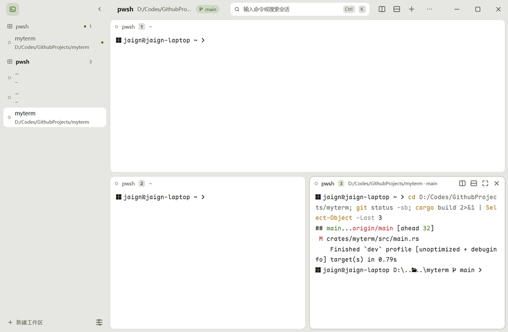

# myterm

一个为 Windows 写的终端。VT 解析交给 [libghostty-vt](https://lib.ghostty.org/vt/index.html) 的 C API，界面用 [GPUI Kit](https://gpui-kit.com)，其余每一层都是自己的代码，并且能单独测试。

[](https://github.com/tiramission/myterm/actions/workflows/ci.yml)
[](https://github.com/tiramission/myterm/releases/latest)


<picture>
  <source media="(prefers-color-scheme: dark)" srcset="docs/screenshot-dark.png">
  
</picture>

终端渲染、键盘与中文输入、多工作区、分屏与拖动比例、选区与复制、滚轮回滚、查找、Kitty 图形协议、深浅主题、自动更新与安装都已人工验证。

界面的样子与交互以 [docs/ui-prototype.html](docs/ui-prototype.html) 为准——那是一份可以直接打开、直接点的稿子。为什么要这样做，写在 [docs/design.md](docs/design.md)。

## 四个决定

**窗口只有一块表面，只有终端是盒子。** 顶栏、侧栏、状态条、查找条、设置、命令面板、关于卡之间没有一条分割线，靠底色、阴影和留白分开。唯一的例外是终端窗格：它装的是文字，需要一圈边界才看得出「被容器装着」。分屏时那些卡片才画边；单个窗格铺满整个工作区，围一圈等于给视图本身画框。

**工作区在侧边，不在顶部。** 顶部那一行留给窗口本身：工作区的名字、它所在的目录、分支、一条通往全部功能的命令入口，然后是分屏与窗口按钮。左侧一栏是工作区栏——每个工作区一个组头，下面是它的窗格，每行两行字：**路径在前**，程序在后。三个都叫 `pwsh` 的窗格，靠的就是这一行路径来区分。

**焦点是描边，不是压暗。** 拿到键盘的卡片把那条细线换深一档；其余卡片保持原样。把未聚焦的窗格调淡会让正在读的字褪色——亮色模式下尤其糟——而终端里的字是这个窗口唯一不能打折的东西。

**强调色是预算，不是调色盘。** 它只说明「这里是当前」和「有东西在动」：应用标记、当前工作区、键盘所在的窗格描边、可拖动的间隙、光标、有输出的状态。换强调色（青柠 / 琥珀 / 天蓝 / 紫）会连带把窗口的中性色往同一个色相拉一点，所以整扇窗是一个家族，而不是一条描边在一扇绿窗里。

## 安装

从 [Releases](https://github.com/tiramission/myterm/releases/latest) 下载 `myterm.exe` 直接运行即可，不需要管理员权限。

第一次启动时顶栏下面会出现一条提示带，点「安装」把程序装到 `%LOCALAPPDATA%\Programs\myterm`：建开始菜单和桌面快捷方式、写入「设置 → 应用」里的卸载项，然后重启到装好的副本。之后启动自动检查新版本，顶栏出现徽章时点一下即可升级。

卸载走同一个 `--uninstall`，在「设置 → 应用」里点卸载，或在关于卡里点「卸载」。


## 快捷键

| 按键 | 作用 |
| --- | --- |
| `Ctrl+K` | 命令面板（命令、会话） |
| `Ctrl+Shift+T` | 新建工作区 |
| `Ctrl+Shift+Q` | 关闭工作区 |
| `Ctrl+Shift+R` | 恢复刚关掉的工作区（6 秒内） |
| `Ctrl+Shift+W` | 关闭窗格 |
| `Ctrl+Shift+D` | 向右分屏 |
| `Ctrl+Shift+E` | 向下分屏 |
| `Ctrl+Shift+Z` | 缩放当前窗格（`Esc` 退出） |
| `Ctrl+Shift+B` | 收起 / 展开侧栏 |
| `Ctrl+Shift+F` | 查找（`F3` / `Shift+F3` 上下条） |
| `Ctrl+Shift+C` / `Ctrl+Shift+V` | 复制选区 / 粘贴 |
| `Ctrl+Shift+L` | 切换深浅主题 |
| `Ctrl+,` | 设置 |
| `Ctrl+Tab` / `Ctrl+1..9` | 切换 / 直达工作区 |
| `Alt+方向键` | 切换窗格 |

复制粘贴用带 `Shift` 的组合，因为终端必须把 `Ctrl+C`（中断前台程序）和 `Ctrl+V`（readline 的引号插入）原样交给 shell。
`Ctrl+F` 同理留给 shell 的前移一个字符，查找因此也是 `Ctrl+Shift+F`。退出是 `Alt+F4` 或应用菜单里的「退出」。

## 功能

### 终端

- **渲染**：自定义 `Element` 按行迭代绘制，支持粗体、斜体、下划线、反显、隐藏、删除线、上划线；宽字符占两格。默认字体 Maple Mono NF CN（自带中文字形与 Nerd Font 图标），未安装时回退到系统等宽字体。
- **输入**：普通字符、功能键、方向键、`Ctrl` 组合键都交给解析器编码，所以 application cursor keys、modifyOtherKeys 等模式自动正确。
- **中文输入**：窗格把自己注册为平台文本输入目标，输入法提交后写入 PTY；候选窗跟随光标。
- **光标**：竖线、块、下划线，或者跟随程序（shell 在提示符处换竖线）。块状时会把下面的字符反色重绘，光标压住的那一格仍然可读。
- **选区**：按住左键拖动高亮，`Ctrl+Shift+C` 复制。没有选区时复制不做任何事——把整屏塞进剪贴板很少是想要的。
- **滚轮**：回滚视口，超出半屏自动回到底部；有历史时右侧显示轨道与滑块。
- **查找**：`Ctrl+Shift+F` 打开窗格内的查找条。走的是终端库自己的搜索接口，**覆盖回滚区**，不只是当前屏幕；`Enter` / `F3` 会在命中之间走，并把视口滚到那一条。
- **退出提示**：进程退出后在窗格底部显示退出码，保留最后一帧输出。
- **图形**：支持 Kitty 图形协议，`chafa -f kitty` 之类的输出会按声明的层与 z 序画进窗格；也回答 `CSI 14/16/18/19 t` 尺寸查询，图形程序因此能算出正确的单元格大小。

### 窗口与侧栏

- **布局**：两列。左侧工作区栏贯穿整个高度，应用标记就在它要打开的角落里；右侧是 44px 顶栏
  （工作区名 · 目录 · 分支 · 命令入口 · 分屏与新建 · 应用菜单 · 窗口按钮）加上面的工作区。
- **命令入口**：顶栏中间那条 `Ctrl+K` 的输入框是鼠标用户的入口。两组：命令与会话。会话行是
  **一个窗格**，右侧写 `工作区 · 目录`，点了直接切过去并聚焦它。
- **工作区栏**：窗口里唯一的工作区入口。每个工作区一个组头（字形、名字、窗格数），下面是它的
  窗格行；每行两行字，路径在前、程序在后，路径报不出来时才退回程序名。窄条时一个工作区一个方块，
  当前工作区整块带底色，每个窗格一枚块，右上角是状态点。
- **关闭**：窗格、工作区、窗口三种粒度走同一个确认卡，写明会结束几个终端；关掉的工作区在 6 秒内
  可以撤销，撤销窗口过期当它一起结束。
- **主题**：跟随系统深浅色启动，`Ctrl+Shift+L` 或应用菜单切换。终端前景、背景、光标与 ANSI 16 色一起换，不只是外壳——这些值也注入解析器，所以查询颜色的程序得到和屏幕一致的结果。

### 设置

设置是工作区右侧的一列，不是浮在终端上的卡片：改字号时左边的网格就在旁边变，窗格既不缩小也不被遮住。

- **三页**：外观（主题、密度、强调色）、终端（默认 shell、字号、光标、回滚行数、shell 集成）、快捷键。
- **立即生效**：每一项改完当场生效并写盘。
- **配置文件**：`%LOCALAPPDATA%\myterm\config.txt`，平铺的 `key = value`；坏行、未知键、越界值
  都会被忽略，文件损坏只会退回默认值而不会让程序打不开。

### shell 集成

侧栏的路径、顶栏的目录和分支，都要 shell 自己报出来（OSC 7）。PowerShell 默认不报，所以这两处
在它下面一直是空的——除非打开设置里的「shell 集成」。

打开后新窗格用包装过的提示符启动：保存原来的 `prompt` 函数，先写一段 OSC 7，再调用它。默认关闭，
因为它改写的是用户的提示符；也只对之后新建的窗格生效，正在跑的 shell 没法从外部改提示符。
目前只覆盖 PowerShell——`cmd` 没有可包装的提示符函数，`wsl` 跑的是另一个 shell。

### 分屏

- 左右 `Ctrl+Shift+D`、上下 `Ctrl+Shift+E`、关闭 `Ctrl+Shift+W`，`Alt+方向键` 按几何位置切换。
- 分成多个窗格后，每张卡片顶部多一行窗格头（状态、名字、序号、`目录 · 分支`，右边是分屏 / 缩放 / 关闭）。单窗格时不显示——侧栏已经说了它是谁。
- **焦点是更亮的一条线**：拿到键盘的卡片把那条中性细线换深一档，其余卡片原样。强调色在这片区域只说明「哪个工作区是当前的」，不被窗格借用。
- 缩放是临时的：`zoomed` 只影响渲染，布局树不动，放开时每个窗格回到原处。

## 构建

前置：

- Windows 10 1809+ / Windows 11，MSVC 目标（`x86_64-pc-windows-msvc`）
- Rust 1.90+（edition 2024）
- Visual Studio Build Tools（C++ 工作负载）与 Windows SDK

不需要 CMake、Zig 或任何系统级依赖：`libghostty-vt` 的静态库已随仓库提供，构建机不需要网络。

```sh
cargo run -p myterm                       # 打开窗口
cargo test --workspace                    # VT 绑定、布局、搜索、配置、安装、版本比较
cargo clippy --workspace --all-targets    # CI 把警告当错误
cargo fmt --all --check
```

## 结构

```
crates/
  vt-sys/   libghostty-vt 1.0.1 的裸 FFI 声明 + 预编译静态库
  vt/       安全封装：所有权、错误、颜色、渲染状态、按键编码、图形、搜索
  pty/      ConPTY 进程与读写线程
  myterm/   GPUI Kit 界面：侧栏、窗格、渲染、快捷键、设置、更新与安装
```

依赖只向下：`myterm → pty/vt → vt-sys`。`vt-sys` 之外没有 `unsafe`。

`vt-sys` 的静态库是用 Zig 从 `vt-1.0.1` 标签以 MSVC 目标构建后入库的。Ghostty 也发 Windows 预编译包，但那份是 gnu ABI，其目标文件用了 `link.exe` 拒绝的 COMDAT 布局（`LNK1143`），链接不进 MSVC 的 Rust 二进制。

## 已知限制

- **系统磨砂材质透不出来**：Windows 后端通过 DirectComposition 呈现不透明表面，DWM 的 Mica / Acrylic 被它盖住。窗口改用比网格更浅的外壳色来分层。
- **只有 Windows。**
- **路径与分支依赖 shell 报告**：默认的 PowerShell 不报，需要打开「shell 集成」；`cmd` 与 `wsl` 暂不支持。
- **撤销只到工作区**：关掉的窗格不可恢复。
- **自动更新只替换可执行文件**，不处理同目录的其他文件；目前也只有这一个文件。
- **字体依赖本机**安装 Maple Mono NF CN。
